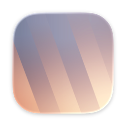
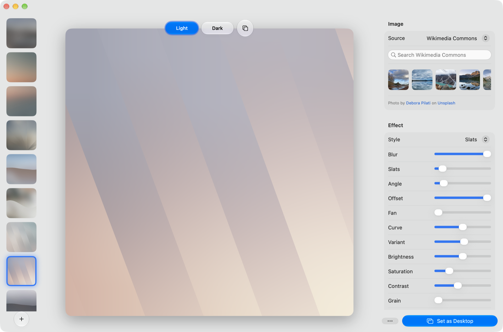

<p align="center">
  
</p>

<h1 align="center">Lurent</h1>

<p align="center">
  Turn any photo into a soft, abstract wallpaper for your Mac.
</p>

<p align="center">
  <a href="LICENSE"></a>
  
  
  
  <a href="https://github.com/philippherzig/lurent/commits/main"></a>
  <a href="https://lurent.app"></a>
</p>

<p align="center">
  <a href="https://github.com/philippherzig/lurent/releases/latest/download/Lurent.zip"></a>
</p>

<p align="center">
  
</p>

## Features

- **Four styles.** Blur, Mirror, Slats and Liquid, each with its own controls. Liquid
  generates its image from colours alone, no photo needed.
- **Light and dark.** Give each appearance its own photo and settings. Lurent exports
  a dynamic HEIC that macOS switches with the system appearance.
- **Every display, full resolution.** Lurent renders a square 6016 × 6016 master that
  fills any Mac display, landscape or portrait, up to the Pro Display XDR.
- **No banding.** 16-bit rendering with optional film grain keeps smooth gradients
  smooth, even on 10-bit displays.
- **Projects, not exports.** Every wallpaper stays editable as a `.lurent` document in
  `iCloud Drive/Lurent/`, synced across your Macs. No save button.
- **Photos from anywhere.** Search Wikimedia Commons, Pexels or Unsplash, pick from your
  Photos library, or drop in any image file. Every online photo is credited.
- **One click to the desktop.** Set the result as your wallpaper on all screens, export
  it with ⌘S, or drag the preview straight into the Finder.

## Install

[Download the latest release](https://github.com/philippherzig/lurent/releases/latest/download/Lurent.zip),
unzip it and move Lurent to your Applications folder. Builds are signed and
notarized by Apple. Requires macOS 26 or later on Apple Silicon.

## Build from source

```bash
./build.sh
open build/Lurent.app
```

Only the Command Line Tools are needed (`xcode-select --install`), not Xcode.
Without a Developer ID certificate in your keychain the build is signed ad hoc,
which runs fine on your own Mac.

## API keys

Commons needs no key. For the others, open **Lurent › Settings…**:

- **Pexels** works without a key through a shared cache at `pexels.lurent.app`.
  A free key of your own from [pexels.com/api](https://www.pexels.com/api/)
  sends searches straight to Pexels on your own quota.
- **Unsplash** needs your own access key from
  [unsplash.com/developers](https://unsplash.com/developers). A demo app's key
  allows 50 searches an hour, which is plenty for personal use.

Keys are stored in your login keychain and never leave your Mac except to their
own service.

## Distributing a build

For others to run your build, sign it with a Developer ID and notarize it:

```bash
./build.sh                    # picks up a "Developer ID Application" identity
./notarize.sh                 # needs a notarytool keychain profile "lurent-notary"
./package.sh                  # optional: a notarized .pkg installer
```

Create the notary profile once with
`xcrun notarytool store-credentials lurent-notary --apple-id … --team-id … --password …`
(an app-specific password from account.apple.com).

## Layout

```
Sources/            The app (SwiftUI + Core Image)
Localizations/      UI strings; German is the base language, keys are the German text
workers/pexels-cache/  Cloudflare Worker behind pexels.lurent.app
site/               lurent.app, deployed by Cloudflare Pages on every merge to main
Tools/              Icon and contact-sheet helpers
```

## Photo credits

Every photo from an online source shows its photographer and a link to where it
lives. Commons photos are mostly CC BY-SA; the linked file page states the exact
licence. Unsplash and Pexels photos follow their own licences.

## Contributing

Issues and pull requests are welcome. For anything larger than a fix, open an issue
first so we can agree on the direction. `./build.sh` must pass before a pull request.

## License

MIT, see [LICENSE](LICENSE).
